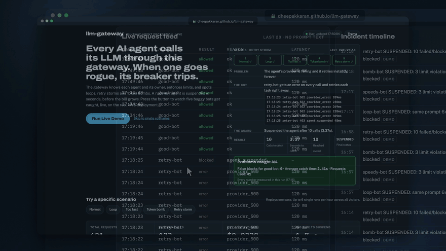
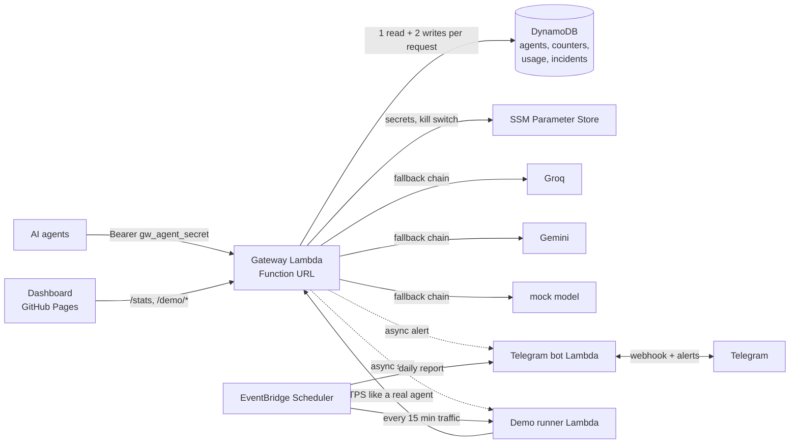
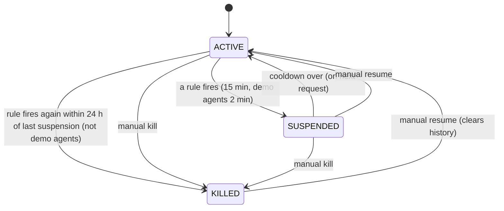

# llm-gateway

A serverless LLM gateway on AWS that catches runaway AI agents: loops, retry storms, token spikes and token bombs. It suspends the agent within seconds, alerts its owner on Telegram, and gives you kill switches. It runs entirely on the AWS always-free tier.

**Live dashboard:** https://dheepakkaran.github.io/llm-gateway/



_Recorded live from the public dashboard: the visitor clicks Run Live Demo and five buggy bots get caught one by one. 4/4 problems caught, 0 false blocks, average catch time 2.46 s, 41 requests._

## The problem

Companies run many AI agents that call LLM APIs directly. When an agent hits a bug and gets stuck in a loop, it can fire thousands of calls an hour. Nobody notices until the bill arrives. There is no fast way to stop it, and often nobody knows who owns it.

## The solution

Every agent calls LLMs only through this gateway, using its own key. The gateway knows each agent and its owner and enforces per-agent limits. It detects runaway behaviour and auto-suspends the agent (a circuit breaker), and alerts the owner on Telegram. It also supports instant manual kill switches, per agent or global. A public dashboard shows everything live and plays a "demo movie" in which buggy bots get caught one by one.

The API is OpenAI-compatible (`POST /v1/chat/completions`). Responses add an `x_gateway` object with the provider used, latency, estimated cost and the agent's status.

## Architecture



## Request pipeline

Rejections happen as early and cheaply as possible:

1. **Global kill switch** (SSM parameter, cached 15 s), otherwise `503`
2. **Key, agent, hash.** The key format is `gw_<agent_id>_<secret>`, so the agent is found with one `GetItem` and no index. Only the SHA-256 hash is stored. A bad key gets `401`.
3. **Agent status.** KILLED gets `403`. SUSPENDED gets `403` with the seconds remaining. If the cooldown is over, the agent flips back to ACTIVE with a conditional write.
4. **Token bomb.** If the estimated prompt tokens (chars/4) exceed `max_prompt_tokens`, the request gets `413` and counts as a violation.
5. **Rate limit.** More than `rpm` requests in the current minute gets `429` and counts as a violation.
6. **Loop detection.** Repeat prompts and token spikes suspend the agent.
7. **Daily token budget**, otherwise `429`
8. **Provider call** with ordered fallback on 429, 5xx or a 10 s timeout
9. **Usage record**: tokens, latency, estimated cost and outcome. Never prompt text.

Steps 3–7 run on one small per-agent "window" item: **one strongly consistent read and one write guarded by a version number** (optimistic locking). A normal request costs **1 read and 2 writes** (window plus usage record). A provider failure adds one more write. If DynamoDB throttles, the gateway **fails closed**: it returns `429` and never calls a provider for a request it couldn't count.

### Detection rules (defaults, overridable per agent)

| Rule | Fires when |
|---|---|
| Repeat prompt | the same normalized prompt (lowercase, collapsed whitespace, all messages) is seen **more than 5 times in 2 minutes** |
| Retry storm | **10 or more** failed or blocked requests in 1 minute |
| Token spike | reserved tokens in the current minute exceed `max_tokens_per_min` (40,000) |
| Repeated violations | **3 or more** token-bomb or rate-limit violations in 5 minutes |

## Agent state machine



Every state change writes an incident record: agent, owner, rule, evidence numbers, calls blocked, estimated cost avoided, action and time. Real agents also send a Telegram alert, for example `leetcode-bot (owner dheepak) SUSPENDED: same prompt 6x in 2 min. Blocked 1 call. Est. cost avoided $0.0003. /resume leetcode-bot`. Demo agents only appear on the dashboard.

## $0 design decisions

| Choice | Paid alternative avoided |
|---|---|
| Lambda **Function URLs** with app-level API keys | API Gateway (per-request pricing) |
| DynamoDB **provisioned 24 RCU / 24 WCU**, no autoscaling, no GSIs | On-demand mode, autoscaling, GSIs (each consumes capacity) |
| Agent ID embedded in the key (`gw_<agent>_<secret>`) | A GSI on the key hash |
| One per-agent window item with optimistic locking, tokens reserved up front | Extra counter writes per request (would blow the 25 WCU budget) |
| Calls blocked while suspended are counted in memory and flushed every 5 s | One write per blocked call, letting a runaway agent eat everyone's capacity |
| SSM Parameter Store **Standard SecureString** with the AWS-managed key | Secrets Manager ($0.40/secret/month), customer-managed KMS keys ($1/key/month) |
| Stats snapshot rebuilt at most every 20 s, compressed, plus 10 s in-memory cache | Table scans per dashboard poll, ElastiCache |
| Demo movie runs inside **one Lambda** | Step Functions |
| No VPC | NAT Gateway (~$32/month) |
| EventBridge Scheduler | An always-on cron server |
| Explicit log groups with **7-day retention** | Never-expiring log storage |
| Dashboard on **GitHub Pages**, alerts on **Telegram** | S3 + CloudFront, SNS SMS / paging tools |
| Mock model for tests, demo and background traffic | Real tokens on every demo click |
| Local Terraform state | S3/DynamoDB remote state |

## Worst-case free-tier usage

The Lambda always-free tier is **1,000,000 requests** and **400,000 GB-seconds** per month. Worst case, assuming demos are triggered as often as the global limits allow (one full movie every 20 minutes, 6 single scenarios every hour, all day, every day) and a 30-day month:

| Source | Calculation | Invocations / month |
|---|---|---|
| Background traffic | 96 runs/day × (1 runner + 3 gateway) × 30 | 11,520 |
| Daily report | 1/day × 30 | 30 |
| Demo movies (cap 120 requests) | 72/day × (1 + 1 start + 120) × 30 | 263,520 |
| Single scenarios (cap 40 requests) | 144/day × (1 + 1 start + 40) × 30 | 181,440 |
| One dashboard tab open 24/7 | `/stats` every 20 s: 4,320/day × 30 | 129,600 |
| Same tab watching every demo | `/demo/status` every 2 s for ~480 s/hour: 5,760/day × 30 | 172,800 |
| **Total** | | **758,910** |

That fits under 1M, with about one dashboard tab kept open around the clock. Real usage (a few visitors for a few minutes each) is a small fraction of this. Polling stops when the tab is hidden.

Compute: the gateway uses 256 MB and about 0.2 s per mock call, so 1M calls is about 50,000 GB-s. A demo movie is about 100 s at 256 MB (25.6 GB-s), so 2,160 movies is about 55,300 GB-s. Single scenarios add about 27,000 GB-s. The worst-case total is **about 135,000 GB-s, under 400,000**. DynamoDB is provisioned, so it can't overspend: the worst it does is throttle, and the gateway fails closed. A $1 AWS Budget alert is the backstop.

The only uncapped input is someone hammering the public URL directly. Each such request is one cheap invocation, and the $1 budget alert would flag it.

## Monitoring

A CloudWatch dashboard (`llmgw`, created by Terraform) puts the whole project on one page. Cost comes first: the estimated bill and charges per service, then 30-day meters for each always-free limit (Lambda requests vs 1M, Lambda GB-s vs 400k, logs vs 5 GB, KMS requests vs 20k). Below that: Lambda invocations, errors, throttles and gateway p50/p95 latency; calls blocked by guard rules and agent state changes (2 log metric filters); DynamoDB read/write units per second against the 24 provisioned units, plus throttles; and estimated AWS charges. It uses 1 of the 3 always-free dashboards, about 45 metrics, 2 custom metrics, and no Logs Insights widgets (those bill per GB scanned). The estimated-charges tile needs "Receive CloudWatch billing alerts" turned on once in Billing preferences.

## Measured results

From `simulator/buggy_agent.py` against the deployed gateway. Full report: [reports/results.md](reports/results.md).

| Scenario | Caught | Calls before suspension | Seconds to suspend | Calls that reached a provider |
|---|---|---|---|---|
| loop | 3/3 | 6 | 2.04 (1.98–2.16) | 5 |
| too_fast (rpm 10) | 3/3 | 13 (throttled from call 11) | 4.50 (4.42–4.54) | 10 |
| token_bomb (50,000 chars) | 3/3 | 1 (rejected with 413) | 0.25 (0.22–0.28) | 0 |
| retry_storm | 3/3 | 10 | 3.56 (3.48–3.67) | 10 |

- **False positives:** 0 of 20 normal requests blocked (different Dolly prompts, one every ~3 s).
- **Fallback:** primary model returning 429 on 50% of calls, **30/30 succeeded**, 15 via the backup.
- **Real providers** (`fast` = Groq, then Gemini): 20/20 succeeded, gateway-measured latency **p50 373 ms, p95 971 ms**. Groq served 16; Gemini served 4 after fallback.
- **Full demo movie:** 4/4 problems caught, 0 false blocks, average catch time 2.4 s, 41 requests.

Time-to-suspend is measured client-side, from the first call of the pattern to the response that reported the suspension, at ~3 requests per second.

## Evaluation on real agent traces

Planned for the next milestone (M3b), on [MAST-Data](https://huggingface.co/datasets/mcemri/MAST-Data) (CC BY 4.0). Not run yet, so there are no numbers here.

## Datasets and licenses

- **databricks-dolly-15k** (CC BY-SA 3.0), © Databricks. `simulator/prompts.jsonl` (and its copy `src/prompts.jsonl`) contains 200 instructions sampled with seed 42 from the categories that need no context. The demo, background traffic and simulator use these prompts. Changes: whitespace normalized; only the instruction and category fields kept.
- **MAST-Data** (CC BY 4.0), for M3b. Cemri et al., *Why Do Multi-Agent LLM Systems Fail?*, NeurIPS 2025.

## Setup

You need git, Python 3.12, AWS CLI v2 and Terraform.

1. **AWS account:** enable MFA on root and create a **$1 AWS Budget** first. Use an IAM user or SSO with short-lived CLI credentials, region `us-east-1`.
2. **Secrets** live in SSM Parameter Store as Standard SecureStrings (AWS-managed key, no extra cost). Each value is typed at a hidden prompt, so it never lands in your shell history. Groq and Gemini are optional, because the `mock` model needs no keys.
   ```bash
   P=/llm-gateway
   for name in groq_api_key gemini_api_key telegram_bot_token telegram_chat_id; do
     printf "%s: " "$name"; read -rs v; echo
     aws ssm put-parameter --name "$P/$name" --type SecureString --tier Standard --value "$v" --overwrite
   done
   for name in telegram_webhook_secret demo_key_secret; do
     aws ssm put-parameter --name "$P/$name" --type SecureString --tier Standard --value "$(openssl rand -hex 32)" --overwrite
   done
   mkdir -p ~/.llm-gateway && ADMIN_KEY="adm_$(openssl rand -hex 24)" && (umask 077; printf %s "$ADMIN_KEY" > ~/.llm-gateway/admin_key)
   aws ssm put-parameter --name "$P/admin_key_hash" --type SecureString --tier Standard --overwrite \
     --value "$(printf %s "$ADMIN_KEY" | shasum -a 256 | cut -d' ' -f1)"
   ```
   The admin key stays in `~/.llm-gateway/admin_key`; AWS only gets its SHA-256 hash.
3. **Deploy** (Terraform state stays local):
   ```bash
   cd infra
   terraform init
   terraform plan -out=plan.tfplan
   terraform apply plan.tfplan
   ```
   With `aws login`, first export its short-lived credentials for Terraform: `eval "$(aws configure export-credentials --format env)"`. To limit dashboard CORS to your Pages site: `echo 'allowed_origin = "https://<you>.github.io"' > terraform.tfvars`.
4. **Telegram webhook** (registered from inside AWS):
   ```bash
   aws lambda invoke --function-name llmgw-bot --cli-binary-format raw-in-base64-out \
     --payload "{\"type\":\"register_webhook\",\"url\":\"$(terraform output -raw bot_webhook_url)\"}" /dev/stdout
   ```
5. **Dashboard:** set `GATEWAY_URL` in `dashboard/index.html`, push, and enable GitHub Pages with "GitHub Actions" as the source.
6. **Tests:** `python -m pytest -q` (pure logic, no AWS, no real providers).

## Register an agent and call the gateway

```bash
GW=https://<your-function-url>
curl -s -X POST $GW/admin/agents -H "authorization: Bearer $(cat ~/.llm-gateway/admin_key)" \
  -d '{"agent_id":"leetcode-bot","owner":"dheepak","team":"platform","purpose":"solves practice problems","limits":{"rpm":30}}'
# -> {"agent_id":"leetcode-bot","gateway_key":"gw_leetcode-bot_...","note":"Shown once..."}

curl -s $GW/v1/chat/completions -H "authorization: Bearer $GATEWAY_KEY" \
  -d '{"model":"fast","max_tokens":100,"messages":[{"role":"user","content":"What is a circuit breaker?"}]}'
```

```python
from openai import OpenAI  # any OpenAI-compatible client works
client = OpenAI(base_url="https://<your-function-url>/v1", api_key="gw_leetcode-bot_...")
r = client.chat.completions.create(model="fast", max_tokens=100,
                                   messages=[{"role": "user", "content": "Hello"}])
print(r.choices[0].message.content)
```

Models: `mock` (no key needed), `mock-fallback`, `fast` (Groq `qwen/qwen3.8-27b`, then Gemini `gemini-flash-lite-latest`), `smart` (Groq `openai/gpt-oss-120b`, then Gemini `gemini-flash-latest`), or `provider/model`.

Admin routes (Bearer admin key): `POST /admin/agents`, `GET /admin/agents`, `POST /admin/agents/{id}/kill|resume|limits`, `POST /admin/kill-all`, `POST /admin/unkill-all`. Telegram: `/status /agents /kill <id> /resume <id> /killall /unkillall /incidents`.

## Teardown

```bash
cd infra && terraform destroy
```

This removes every AWS resource Terraform created. The SSM secrets you created by hand stay until you delete them (`aws ssm delete-parameters --names ...`).
